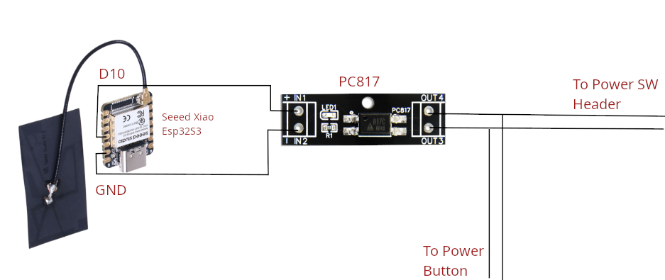
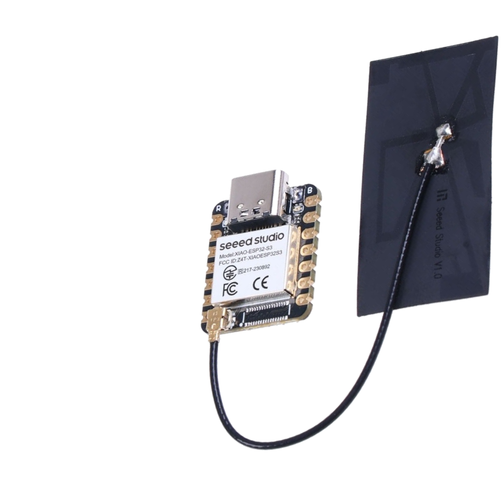
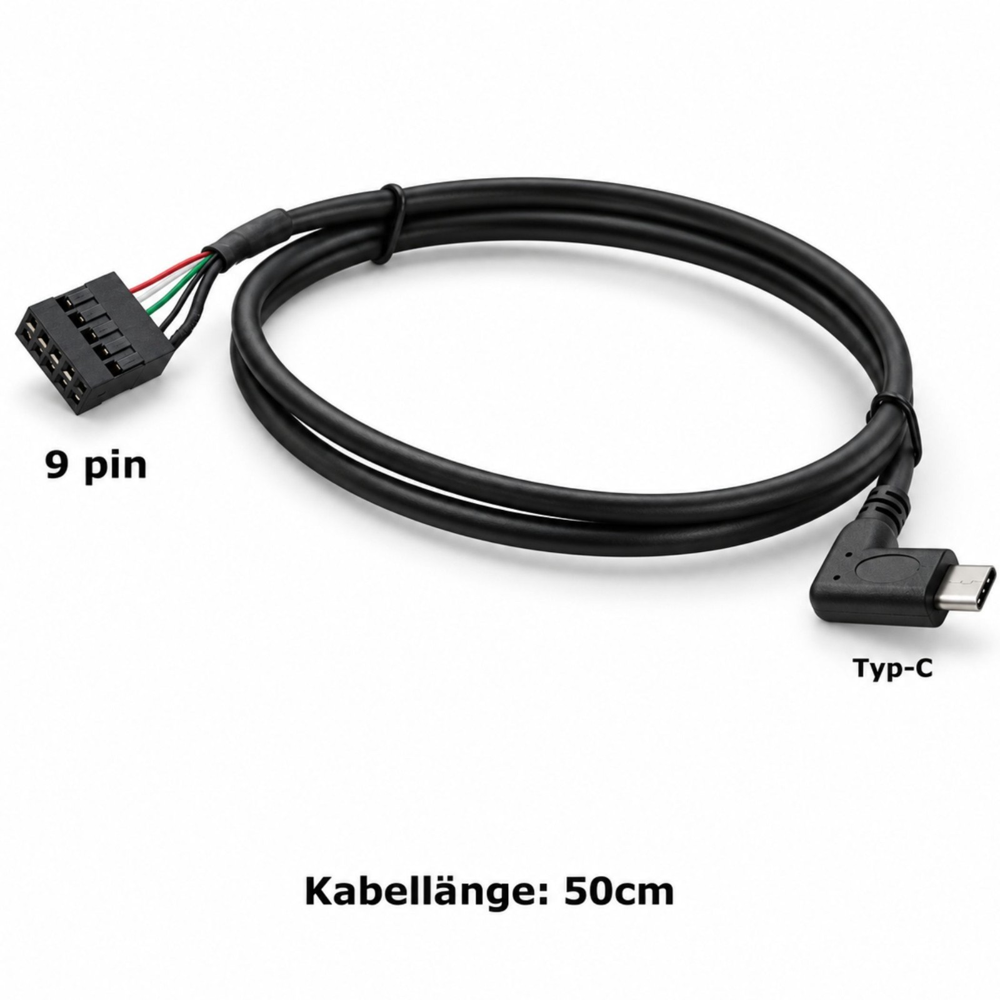
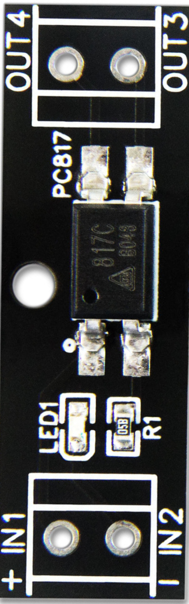
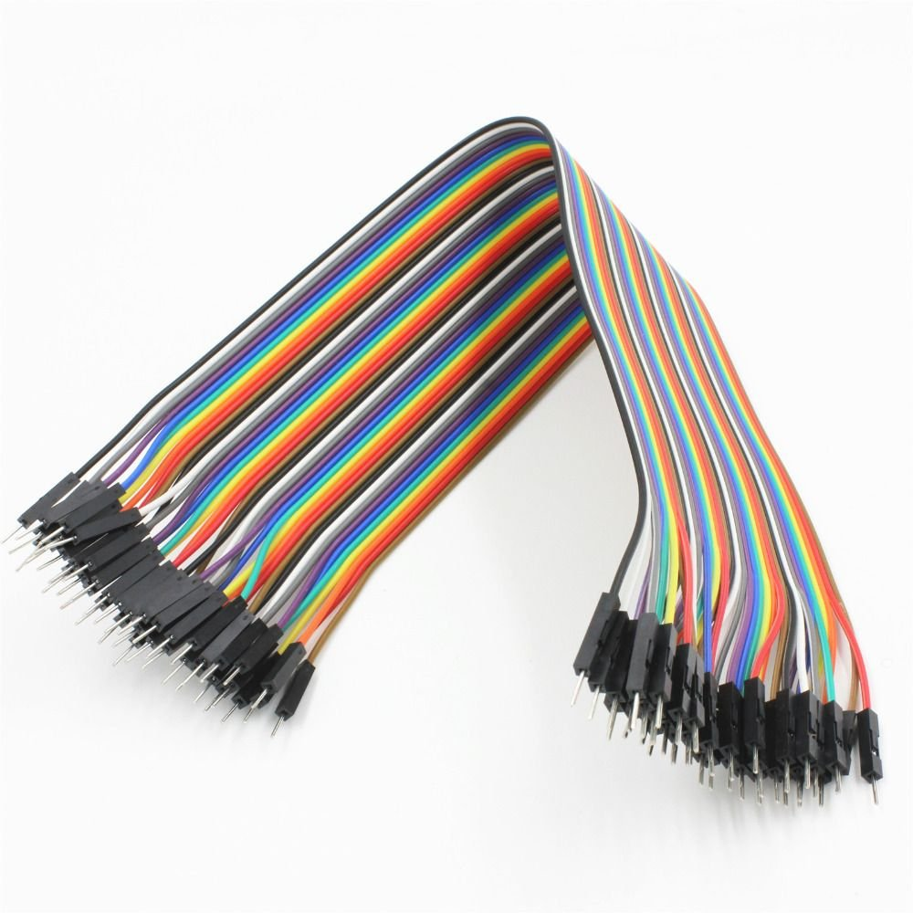
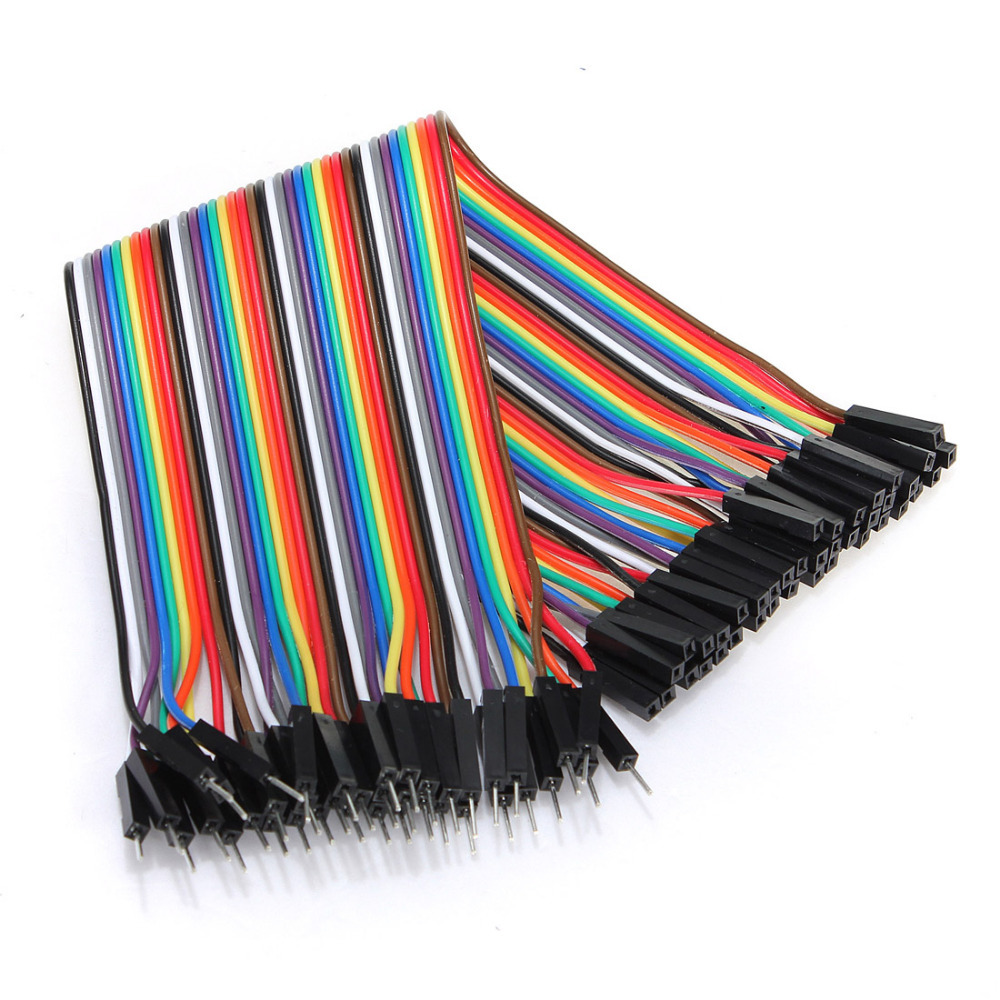
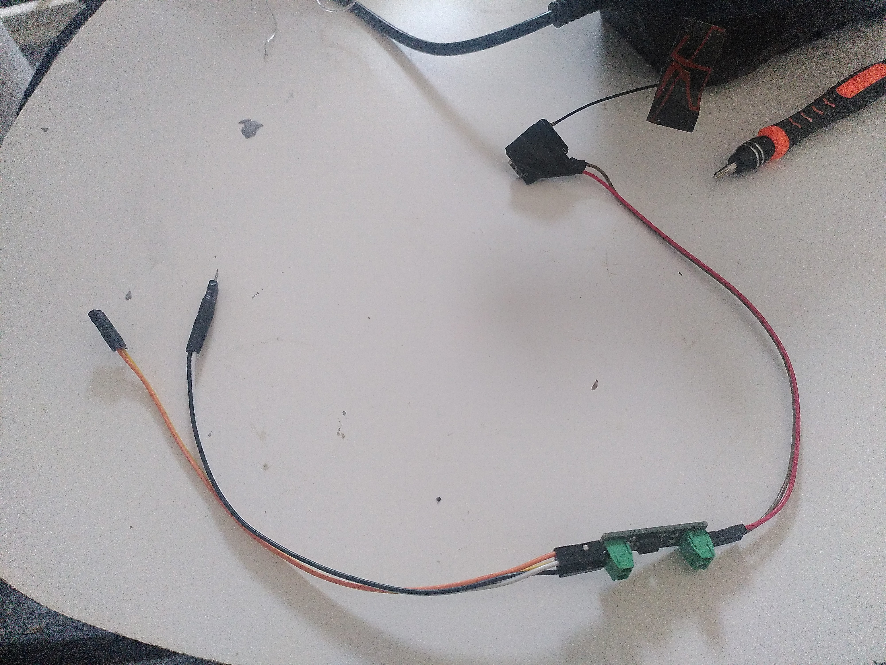
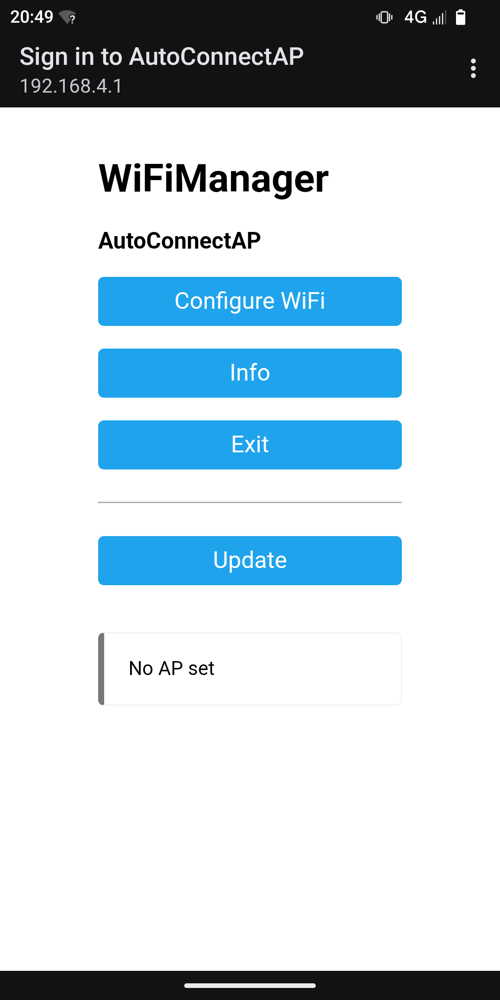
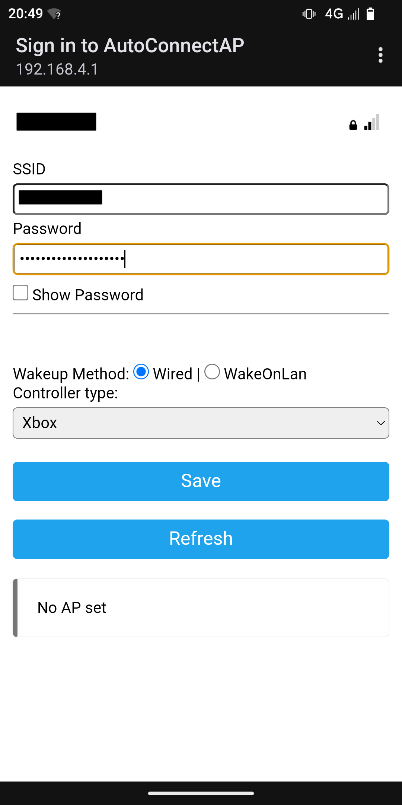
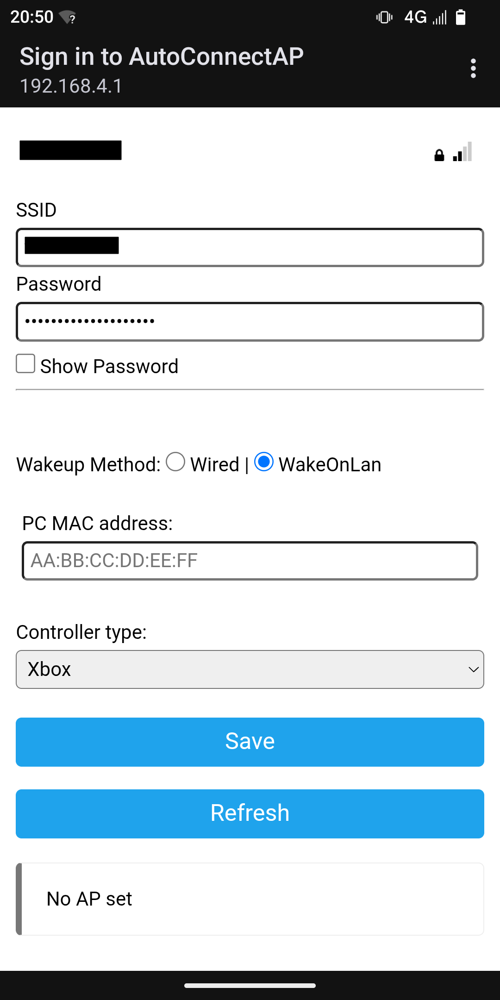

<div align="center">

<!-- HERO IMAGE: finished board next to the PC, controller in front. Recommended size 1200x600 -->


# ESP32 Bluetooth PC Power Controller

**Turn your PC on with your game controller. Set it up from your phone, no code editing.**
An ESP32 (XIAO ESP32-S3) listens for a button press from an Xbox or Steam controller, then presses your PC's power button through an optocoupler, or wakes it with Wake-on-LAN. Everything is chosen in a setup page served by the ESP32 itself.


[Demo](#demo) • [Features](#features) • [How it works](#how-it-works) • [Controllers](#supported-controllers) • [What you need](#what-you-need) • [Wiring](#wiring) • [Setup](#setup) • 

</div>

---

## Why?

**The power button is too far away**

## Demo
todo
## Features

| Feature | Description |
|---|---|
 **Phone-based setup** | The ESP32 opens its own Wi-Fi network with a setup page (WiFiManager). Pick your wake method and controller there. |
 **Settings saved in flash** | Your choices are stored as a JSON file in SPIFFS. |
 **Controller as remote** | Switch on your controller and the PC starts. |
 **Wired power-on** | The ESP32 drives an optocoupler wired in parallel with the case power button. |
 **Electrically isolated** | The optocoupler keeps the ESP32 and the motherboard galvanically separated. |
 **Wireless power-on** | The ESP32 sends a Wake-on-LAN magic packet to the PC's Ethernet card. You type the PC's MAC address in the setup page. |
 **Keeps the case button** | Wired in parallel, so the normal power button still works. |

---

## How it works

### Wake method: Optocoupler

1. The ESP32 sets one GPIO **HIGH** for about **1500 ms**. 
2. The transistor inside the optocoupler briefly connects the two `PWR_SW` pins, which equals pressing the case button.
3. The GPIO goes **LOW** and the PC boots.

### Wake method: Wake-on-LAN

1. The ESP32 builds a **magic packet**: 6 bytes of `FF` followed by the PC's MAC address repeated 16 times, 102 bytes in total.
2. It sends it as a **UDP broadcast** (port 9) on your local network, using the Wi-Fi you picked in the setup page.
3. The PC's Ethernet card, which stays powered when the PC is "off", sees its own MAC and tells the motherboard to start.

> ⚠️ WoL needs the **PC connected by Ethernet cable, and you need to activate WOL on the bios**. The ESP32 connects to your router over Wi-Fi.

### Which method should I use?

| | Optocoupler | Wake-on-LAN |
|---|---|---|
| Needs wire to motherboard | ✅ yes | ❌ no |
| Needs BIOS/OS setup | ❌ no | ✅ yes |
| Works from any power-off state | ✅ yes | ⚠️ depends on NIC |
| Works on any PC | ✅ yes | ⚠️ needs WoL support |
| Needs home Wi-Fi | ⚠️ Only for the first setup | ✅ yes |

---

## Supported controllers

I only tested this on the controller I own, which is an Xbox One controller on an ASUS motherboard

> ⚠️ **The XIAO ESP32-S3 has Bluetooth Low Energy only.** It has no Bluetooth Classic (BR/EDR), 
> - **DualSense might not work** on the S3. Use an original ESP32 (ESP32-WROOM / WROVER) if you want it.

---

## What you need

| # | Image | Part | Qty |
|---|---|---|---|
| 1 |  | XIAO ESP32-S3 | 1 piece with antenna attached |
| 2 |  | USB-C to 9-pin motherboard adapter | 1 piece |
| 3 |  | Optocoupler PC817 | 1 piece with soldered claps |
| 4 |  | Male-male jumper cables | 4 wires |
| 5 |  | Female-male jumper cables | 2 wires |

- ⚠️ Checkout the assets folder


## Wiring

> ⚠️ **Safety:** Switch the PC off and unplug it from the wall before touching the motherboard header. I am not responsible for any damage, this is a hobby project.


### Connections

See the schematics.

> Wake-on-LAN only users can skip all the wiring above.

### Finding the correct `PWR_SW` pins

Usually in the F-Panel but look up your motherboard manual.

---

## Setup

### 1. Flash the firmware

1. Install **PlatformIO**
2. This project is set up for Seeed Xiao ESP32S3 so if you have another board you need to modify ***platfomio.ini*** file accordinly 
3. Clone and upload:

```bash
git clone https://github.com/makkorjamal/ESP32PowerOn.git
cd ESP32PowerOn
pio run -t upload
```
### Connect to the Esp32 hotspot **AutoConnectAP** and setup

<div align="center">

<!-- main image -->


<br>

<!-- three thumbnails -->




</div>

if you want to re-setup you need to erase your ESP32 and reflash

```bash
pio run --target erase
pio run --target upload
```
### 2. PC Setup for linux
1. You need to copy the python script /usr/local/bin/ ( install python-serial as well)
2. You need to copy the ***esp32-pcstate.service*** service file enable and start it using systemctl
3. If you need to wake your pc from sleep then you need to copy pcstate.sh

```bash
sudo cp pcstate.sh /usr/lib/systemd/system-sleep/pcstate
sudo chmod +x /usr/lib/systemd/system-sleep/pcstate
sudo chown root:root /usr/lib/systemd/system-sleep/pcstate
```
### 2. PC Setup for Windows

To do

## Credits

- [WiFiManager](https://github.com/tzapu/WiFiManager) by tzapu: captive-portal setup for ESP32.
- [ArduinoJson](https://arduinojson.org) by Benoit Blanchon.

## Contributing

Issues and pull requests are welcome. Share your wiring photos and motherboard models that work. I will merge your request if you send a demo video that shows your setup working

## License

GPLv3. See [LICENSE](LICENSE).

